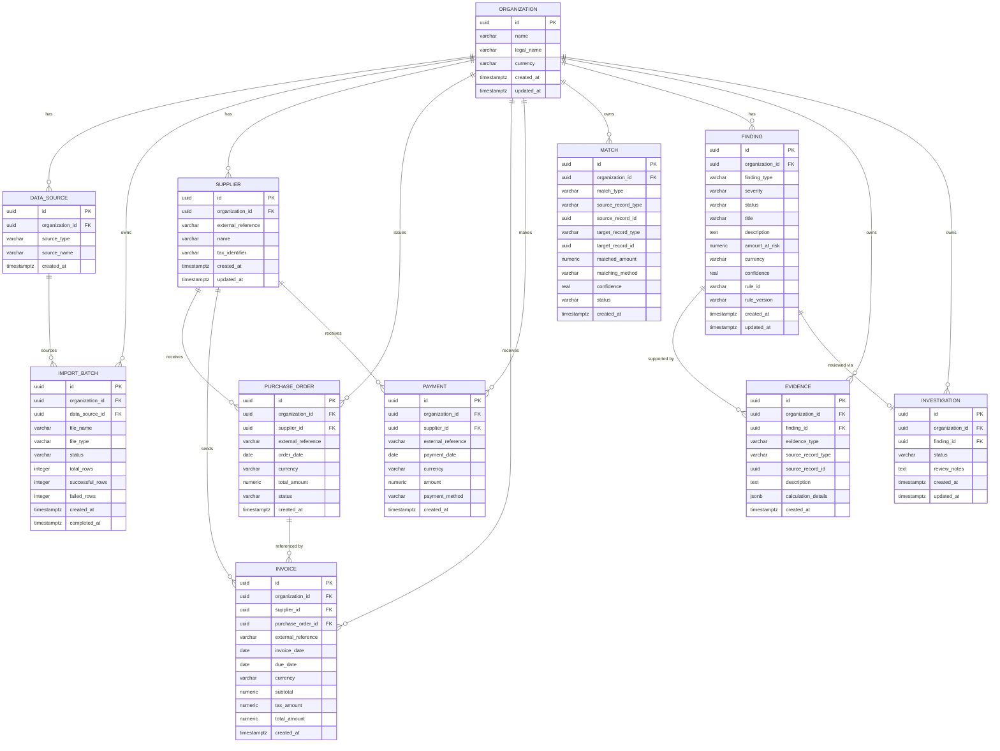

# Data Model

**Project:** MarginGuard
**Sprint:** MG-S0.2
**Status:** Accepted
**Last Updated:** 2025-11-14
**ADR Reference:** ADR-005, ADR-006
**Domain Model Reference:** [domain-model.md](domain-model.md)

---

## 1. Purpose

This document defines the database schema for MarginGuard. It maps the domain entities from `domain-model.md` to PostgreSQL tables, specifies column types, constraints, indexes, and includes an ER diagram.

The schema is designed to support MG-S1.1 (Data Ingestion) without requiring structural changes.

---

## 2. Technology

| Component | Choice | Rationale |
|---|---|---|
| Database | PostgreSQL 15+ | JSONB support, robust constraints, industry standard |
| ORM | SQLAlchemy 2.0 | Declarative models, async-ready, already in `pyproject.toml` |
| Migrations | Alembic | Already declared as dependency, standard for SQLAlchemy |
| Primary Keys | UUID v4 | Non-sequential, safe in URLs, no enumeration risk |
| Monetary Columns | `NUMERIC(18,4)` | Exact decimal storage, 4 decimal places for sub-unit precision |
| Timestamps | `TIMESTAMP WITH TIME ZONE` | UTC storage, timezone-aware |
| JSON Fields | `JSONB` | For `calculation_details` in Evidence |

---

## 3. ER Diagram

## 4. Table Definitions

### 4.1 `organizations`

| Column | Type | Constraints | Notes |
| :--- | :--- | :--- | :--- |
| `id` | `UUID` | PK, default `gen_random_uuid()` | |
| `name` | `VARCHAR(255)` | `NOT NULL` | |
| `legal_name` | `VARCHAR(255)` | `NULLABLE` | |
| `currency` | `CHAR(3)` | `NOT NULL` | ISO 4217, uppercase |
| `created_at` | `TIMESTAMPTZ` | `NOT NULL`, default `now()` | |
| `updated_at` | `TIMESTAMPTZ` | `NOT NULL`, default `now()` | |

- **Indexes:** None beyond PK. Low-cardinality table.

---

### 4.2 `data_sources`

| Column | Type | Constraints | Notes |
| :--- | :--- | :--- | :--- |
| `id` | `UUID` | PK | |
| `organization_id` | `UUID` | `NOT NULL`, FK → `organizations(id)` | |
| `source_type` | `VARCHAR(50)` | `NOT NULL` | Open enum |
| `source_name` | `VARCHAR(255)` | `NOT NULL` | |
| `created_at` | `TIMESTAMPTZ` | `NOT NULL`, default `now()` | |

- **Indexes:** `ix_data_sources_organization_id`

---

### 4.3 `import_batches`

| Column | Type | Constraints | Notes |
| :--- | :--- | :--- | :--- |
| `id` | `UUID` | PK | |
| `organization_id` | `UUID` | `NOT NULL`, FK → `organizations(id)` | |
| `data_source_id` | `UUID` | `NOT NULL`, FK → `data_sources(id)` | |
| `file_name` | `VARCHAR(500)` | `NOT NULL` | |
| `file_type` | `VARCHAR(20)` | `NOT NULL` | |
| `status` | `VARCHAR(30)` | `NOT NULL`, default `'pending'` | `CHECK` in allowed values |
| `total_rows` | `INTEGER` | `NULLABLE` | |
| `successful_rows` | `INTEGER` | `NOT NULL`, default `0` | |
| `failed_rows` | `INTEGER` | `NOT NULL`, default `0` | |
| `created_at` | `TIMESTAMPTZ` | `NOT NULL`, default `now()` | |
| `completed_at` | `TIMESTAMPTZ` | `NULLABLE` | |

- **Constraints:**
  - `CHECK (status IN ('pending', 'processing', 'completed', 'partially_completed', 'failed'))`
  - `CHECK (successful_rows >= 0 AND failed_rows >= 0)`
  - `CHECK (total_rows IS NULL OR (successful_rows + failed_rows) <= total_rows)`
- **Indexes:** `ix_import_batches_organization_id`, `ix_import_batches_status`

---

### 4.4 `suppliers`

| Column | Type | Constraints | Notes |
| :--- | :--- | :--- | :--- |
| `id` | `UUID` | PK | |
| `organization_id` | `UUID` | `NOT NULL`, FK → `organizations(id)` | |
| `external_reference` | `VARCHAR(100)` | `NULLABLE` | |
| `name` | `VARCHAR(255)` | `NOT NULL` | |
| `tax_identifier` | `VARCHAR(50)` | `NULLABLE` | |
| `created_at` | `TIMESTAMPTZ` | `NOT NULL`, default `now()` | |
| `updated_at` | `TIMESTAMPTZ` | `NOT NULL`, default `now()` | |

- **Constraints:**
  - `UNIQUE (organization_id, external_reference)` where `external_reference IS NOT NULL` (partial unique index)
- **Indexes:** `ix_suppliers_organization_id`, `ix_suppliers_name` (for search)

> **Design Note:** No global uniqueness on `name`. Two suppliers in the same organization may share a name.

---

### 4.5 `purchase_orders`

| Column | Type | Constraints | Notes |
| :--- | :--- | :--- | :--- |
| `id` | `UUID` | PK | |
| `organization_id` | `UUID` | `NOT NULL`, FK → `organizations(id)` | |
| `supplier_id` | `UUID` | `NOT NULL`, FK → `suppliers(id)` | |
| `external_reference` | `VARCHAR(100)` | `NOT NULL` | |
| `order_date` | `DATE` | `NOT NULL` | |
| `currency` | `CHAR(3)` | `NOT NULL` | |
| `total_amount` | `NUMERIC(18,4)` | `NOT NULL` | |
| `status` | `VARCHAR(30)` | `NOT NULL` | |
| `created_at` | `TIMESTAMPTZ` | `NOT NULL`, default `now()` | |

- **Constraints:**
  - `CHECK (total_amount >= 0)`
- **Indexes:** `ix_purchase_orders_organization_id`, `ix_purchase_orders_supplier_id`, `UNIQUE (organization_id, external_reference)` (PO numbers unique per org)

---

### 4.6 `invoices`

| Column | Type | Constraints | Notes |
| :--- | :--- | :--- | :--- |
| `id` | `UUID` | PK | |
| `organization_id` | `UUID` | `NOT NULL`, FK → `organizations(id)` | |
| `supplier_id` | `UUID` | `NOT NULL`, FK → `suppliers(id)` | |
| `purchase_order_id` | `UUID` | `NULLABLE`, FK → `purchase_orders(id)` | |
| `external_reference` | `VARCHAR(100)` | `NOT NULL` | Invoice number |
| `invoice_date` | `DATE` | `NOT NULL` | |
| `due_date` | `DATE` | `NULLABLE` | |
| `currency` | `CHAR(3)` | `NOT NULL` | |
| `subtotal` | `NUMERIC(18,4)` | `NOT NULL` | |
| `tax_amount` | `NUMERIC(18,4)` | `NOT NULL` | |
| `total_amount` | `NUMERIC(18,4)` | `NOT NULL` | |
| `created_at` | `TIMESTAMPTZ` | `NOT NULL`, default `now()` | |

- **Constraints:**
  - `CHECK (subtotal >= 0)`
  - `CHECK (tax_amount >= 0)`
  - `CHECK (total_amount >= 0)`
  - `CHECK (total_amount = subtotal + tax_amount)` — enforced at DB level as a safety net; primary validation is in the domain layer
- **Indexes:** `ix_invoices_organization_id`, `ix_invoices_supplier_id`, `ix_invoices_external_reference`

> **Design Note:** No uniqueness constraint on `external_reference` alone. Invoice numbers repeat across suppliers and organizations. Duplicate detection is a business-logic concern, not a database constraint.

---

### 4.7 `payments`

| Column | Type | Constraints | Notes |
| :--- | :--- | :--- | :--- |
| `id` | `UUID` | PK | |
| `organization_id` | `UUID` | `NOT NULL`, FK → `organizations(id)` | |
| `supplier_id` | `UUID` | `NULLABLE`, FK → `suppliers(id)` | |
| `external_reference` | `VARCHAR(100)` | `NULLABLE` | |
| `payment_date` | `DATE` | `NOT NULL` | |
| `currency` | `CHAR(3)` | `NOT NULL` | |
| `amount` | `NUMERIC(18,4)` | `NOT NULL` | |
| `payment_method` | `VARCHAR(50)` | `NULLABLE` | |
| `created_at` | `TIMESTAMPTZ` | `NOT NULL`, default `now()` | |

- **Constraints:**
  - `CHECK (amount > 0)`
- **Indexes:** `ix_payments_organization_id`, `ix_payments_supplier_id`

---

### 4.8 `matches`

| Column | Type | Constraints | Notes |
| :--- | :--- | :--- | :--- |
| `id` | `UUID` | PK | |
| `organization_id` | `UUID` | `NOT NULL`, FK → `organizations(id)` | |
| `match_type` | `VARCHAR(50)` | `NOT NULL` | |
| `source_record_type` | `VARCHAR(30)` | `NOT NULL` | |
| `source_record_id` | `UUID` | `NOT NULL` | |
| `target_record_type` | `VARCHAR(30)` | `NOT NULL` | |
| `target_record_id` | `UUID` | `NOT NULL` | |
| `matched_amount` | `NUMERIC(18,4)` | `NOT NULL` | |
| `matching_method` | `VARCHAR(50)` | `NOT NULL` | |
| `confidence` | `REAL` | `NOT NULL` | |
| `status` | `VARCHAR(20)` | `NOT NULL`, default `'proposed'` | |
| `created_at` | `TIMESTAMPTZ` | `NOT NULL`, default `now()` | |

- **Constraints:**
  - `CHECK (confidence >= 0.0 AND confidence <= 1.0)`
  - `CHECK (matched_amount > 0)`
  - `CHECK (source_record_id != target_record_id)`
  - `CHECK (match_type IN ('invoice_to_payment', 'invoice_to_purchase_order', 'payment_to_invoice'))`
  - `CHECK (status IN ('proposed', 'confirmed', 'rejected'))`
- **Indexes:** `ix_matches_organization_id`, `ix_matches_source` on `(source_record_type, source_record_id)`, `ix_matches_target` on `(target_record_type, target_record_id)`

> **Design Decision:** Polymorphic references instead of typed FK columns. This means the database cannot enforce FK integrity on `source_record_id` / `target_record_id`. Application-layer validation is responsible. See ADR-003 for rationale.

---

### 4.9 `findings`

| Column | Type | Constraints | Notes |
| :--- | :--- | :--- | :--- |
| `id` | `UUID` | PK | |
| `organization_id` | `UUID` | `NOT NULL`, FK → `organizations(id)` | |
| `finding_type` | `VARCHAR(50)` | `NOT NULL` | |
| `severity` | `VARCHAR(20)` | `NOT NULL` | |
| `status` | `VARCHAR(20)` | `NOT NULL`, default `'detected'` | |
| `title` | `VARCHAR(500)` | `NOT NULL` | |
| `description` | `TEXT` | `NOT NULL` | |
| `amount_at_risk` | `NUMERIC(18,4)` | `NOT NULL` | |
| `currency` | `CHAR(3)` | `NOT NULL` | |
| `confidence` | `REAL` | `NOT NULL` | |
| `rule_id` | `VARCHAR(100)` | `NOT NULL` | |
| `rule_version` | `VARCHAR(20)` | `NOT NULL` | |
| `created_at` | `TIMESTAMPTZ` | `NOT NULL`, default `now()` | |
| `updated_at` | `TIMESTAMPTZ` | `NOT NULL`, default `now()` | |

- **Constraints:**
  - `CHECK (confidence >= 0.0 AND confidence <= 1.0)`
  - `CHECK (amount_at_risk >= 0)`
  - `CHECK (finding_type IN ('duplicate_invoice', 'duplicate_payment', 'invoice_payment_mismatch', 'purchase_order_price_mismatch', 'unmatched_payment'))`
  - `CHECK (severity IN ('low', 'medium', 'high', 'critical'))`
  - `CHECK (status IN ('detected', 'under_review', 'confirmed', 'dismissed', 'resolved'))`
- **Indexes:** `ix_findings_organization_id`, `ix_findings_status`, `ix_findings_finding_type`, `ix_findings_severity`

---

### 4.10 `evidence`

| Column | Type | Constraints | Notes |
| :--- | :--- | :--- | :--- |
| `id` | `UUID` | PK | |
| `organization_id` | `UUID` | `NOT NULL`, FK → `organizations(id)` | |
| `finding_id` | `UUID` | `NOT NULL`, FK → `findings(id) ON DELETE CASCADE` | |
| `evidence_type` | `VARCHAR(50)` | `NOT NULL` | |
| `source_record_type` | `VARCHAR(30)` | `NOT NULL` | |
| `source_record_id` | `UUID` | `NOT NULL` | |
| `description` | `TEXT` | `NOT NULL` | |
| `calculation_details` | `JSONB` | `NULLABLE` | |
| `created_at` | `TIMESTAMPTZ` | `NOT NULL`, default `now()` | |

- **Indexes:** `ix_evidence_finding_id`, `ix_evidence_organization_id`

---

### 4.11 `investigations`

| Column | Type | Constraints | Notes |
| :--- | :--- | :--- | :--- |
| `id` | `UUID` | PK | |
| `organization_id` | `UUID` | `NOT NULL`, FK → `organizations(id)` | |
| `finding_id` | `UUID` | `NOT NULL`, FK → `findings(id)` | |
| `status` | `VARCHAR(20)` | `NOT NULL`, default `'open'` | |
| `review_notes` | `TEXT` | `NULLABLE` | |
| `created_at` | `TIMESTAMPTZ` | `NOT NULL`, default `now()` | |
| `updated_at` | `TIMESTAMPTZ` | `NOT NULL`, default `now()` | |

- **Constraints:**
  - `CHECK (status IN ('open', 'in_progress', 'concluded'))`
- **Indexes:** `ix_investigations_finding_id`, `ix_investigations_organization_id`

---

## 5. Cross-Cutting Design Decisions

### 5.1 Monetary Precision
All monetary columns use `NUMERIC(18,4)`:
- 18 total digits, 4 decimal places
- Supports values up to `99,999,999,999,999.9999`
- 4 decimal places accommodate currencies with sub-unit precision (e.g., BHD has 3 decimal places; 4 covers all ISO 4217 currencies)
- **Python-side:** Always use `Decimal`, never `float`
- **SQLAlchemy mapping:** `Numeric(18, 4, asdecimal=True)`

### 5.2 Timestamps
- All `created_at` / `updated_at` columns use `TIMESTAMP WITH TIME ZONE`
- Stored in UTC
- Application layer must pass timezone-aware `datetime` objects
- Document dates (`order_date`, `invoice_date`, `payment_date`, `due_date`) use plain `DATE` — these are business dates, not timestamps

### 5.3 Tenant Isolation
Every tenant-scoped table has a `NOT NULL` `organization_id` FK to `organizations(id)`. This is the foundation for row-level security and query scoping.

**Future work (deferred):**
- PostgreSQL Row-Level Security (RLS) policies
- Application middleware that injects `organization_id` from authenticated context
- Never trust client-supplied `organization_id` for authorization

### 5.4 Source Provenance
Imported records (`invoices`, `payments`, `purchase_orders`, `suppliers`) will carry additional provenance columns when MG-S1.1 implements ingestion:
- `import_batch_id` (FK → `import_batches`)
- `source_row_number` (`INTEGER`)
- `original_data` (`JSONB`, the raw imported row)

These columns are not in the initial migration to keep it minimal. They will be added in MG-S1.1 via a follow-up migration. The schema is designed to accommodate them without structural changes.

### 5.5 Soft Deletes
Not implemented in MG-S0.2. If needed later, a `deleted_at TIMESTAMPTZ NULLABLE` column can be added to relevant tables.

---

## 6. Migration Strategy
- **Initial migration (`001_initial_schema`):** Creates all 11 tables with constraints and indexes.
- **Future migrations:** Additive only (new columns, new tables, new indexes). No destructive changes without explicit ADR approval.
- **Rollback:** The initial migration must be fully reversible (`DROP TABLE` in reverse dependency order).
- **Test environment:** Uses SQLite in-memory for unit tests (documented exception — not an architectural change). Integration tests use a dedicated PostgreSQL test database.

---

## 7. What Is NOT in This Schema
- User accounts, roles, permissions (authentication deferred)
- Audit log tables (deferred)
- Exchange rate tables (multi-currency deferred)
- Notification preferences (deferred)
- Line-item tables (header-level matching only for now)